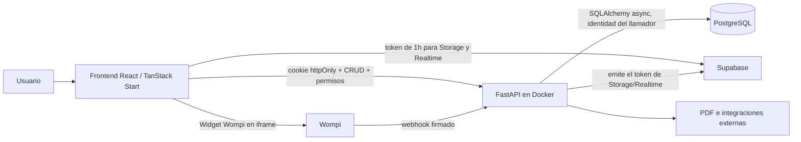

# Arquitectura de Lumen

> **Nota de estado.** Este documento nació como el plan de migración
> desde una arquitectura híbrida (Supabase + FastAPI) hacia una
> arquitectura donde el backend es dueño de todo. **La migración ya
> está completa.** Las secciones de abajo describen el diseño
> original y lo que se decidió; los apartados marcados con
> «implementado» reflejan el estado actual. El plan por fases del
> apartado 12 se conserva como registro de lo que se hizo.

## 1. Decisiones principales

### 1.1 Conservar el frontend existente

Se conservarán:

- React 19 + TypeScript.
- TanStack Start y TanStack Router.
- TanStack Query como capa de estado remoto.
- Tailwind CSS 4 y el design system actual.
- Las rutas y componentes visuales existentes siempre que no contengan lógica sensible.

TanStack Start seguirá siendo el runtime SSR/router del frontend, no el backend de negocio. No se añadirá lógica compleja nueva a server functions de TanStack; esa responsabilidad pertenece a FastAPI.

Esto evita una reescritura innecesaria y mantiene la base SSR con Vite + TanStack Start. Una migración a una SPA Vite pura solo se consideraría si aparece un requisito operativo concreto que lo justifique.

### 1.2 Supabase como plataforma de datos — **implementado**

Supabase es responsable de:

- PostgreSQL (el datastore).
- Supabase Storage (los archivos).
- Supabase Realtime (el chat en vivo).

Supabase **ya no** es responsable de:

- Supabase Auth: el backend emite sus propios tokens (Argon2id + JWT).
- Row Level Security como frontera de autorización: la capa de permisos
  vive en Python (`app/core/permissions.py`), que es el puerto de las
  siete funciones `SECURITY DEFINER` que las migraciones declaraban.
- CRUD desde el navegador: el frontend solo habla con la API.

Storage y Realtime siguen usando sus políticas de RLS, que llaman
`auth.uid()`. El puente es un token de una hora que el backend emite
(`POST /v1/auth/supabase-token`), cuyo `sub` es el id del usuario: con
él, todas las políticas funcionan sin cambios. No es un token de
autenticación — la API no lo acepta.

### 1.3 FastAPI como backend de negocio — **implementado**

FastAPI es responsable de:

- La autenticación completa: registro, login, refresh, logout, reset
  de contraseña, verificación de correo.
- La autorización: quién puede ver y hacer qué, por colegio y por
  curso-materia.
- Todo el CRUD de los nueve módulos de dominio.
- Calificación y puntajes ICFES.
- Agregaciones/comparativos pesados.
- Finalización segura de evaluaciones cuando las claves no deban llegar al cliente.
- Suscripciones, webhooks y entitlements.
- Integraciones externas futuras.

El backend accede a Postgres con SQLAlchemy 2.0 async + asyncpg. Ya
no usa la credencial service role de Supabase para el CRUD: cada
petición va con la identidad del llamador y las políticas se aplican
en Python. La service role sigue usándose para el webhook de Wompi
y para las operaciones de Storage en el backend.

### 1.4 Estilo funcional en Python

El backend evitará jerarquías de clases de servicios/repositorios. Se preferirá:

- routers delgados;
- funciones puras de dominio;
- funciones explícitas para persistencia;
- modelos Pydantic en los límites de entrada/salida;
- dependencias FastAPI para autenticación, configuración y clientes;
- efectos laterales aislados en adaptadores;
- pruebas unitarias directas sobre funciones de scoring y reglas de negocio.

Las clases se reservarán para casos exigidos por Pydantic/FastAPI o cuando aporten una ventaja concreta.

### 1.5 Wompi como proveedor de pagos

[Wompi](https://wompi.com/es/co/desarrolladores) (Bancolombia) es la pasarela elegida para Lumen. Cubre el contexto colombiano con tarjetas, PSE, Nequi y otros métodos. La aplicación nunca maneja datos de tarjeta cruda: el cliente usará el widget oficial o Web Checkout de Wompi para tokenizar, y el backend solo orquestará.

Front-end expone solo:

- `VITE_WOMPI_PUBLIC_KEY` (Browser-safe).
- `VITE_WOMPI_ENVIRONMENT` (`sandbox` o `production`).

Back-end requiere en variables privadas:

- `WOMPI_PUBLIC_KEY` (para `GET /merchants/{public_key}`).
- `WOMPI_PRIVATE_KEY` (autenticación de servidor).
- `WOMPI_INTEGRITY_KEY` (firma de integridad de transacciones).
- `WOMPI_EVENTS_SECRET` (verificación HMAC de webhooks; por defecto Wompi lo devuelve en la respuesta de `/merchants/{public_key}`).
- `WOMPI_API_BASE` (`https://sandbox.wompi.co/v1` por defecto).

Detalles que aplican a Wompi:

- Webhook events llegan a `POST /v1/webhooks/wompi` con un payload que incluye `signature`, `timestamp`, `data.transaction.{id,status,amount_in_cents}`. El backend valida la firma con HMAC-SHA256 sobre `timestamp + transaction.id + transaction.status + transaction.amount_in_cents` usando `events.secret`.
- Flujo recomendado: Web Checkout (popup o redirect) para evitar cualquier contacto del cliente con datos sensibles. Si más adelante se necesita tokenización directa, `POST /payment_sources` recibe la tarjeta del cliente (la librería oficial de Wompi la inyecta en un iframe; el código de Lumen nunca la ve).
- Eventos importantes para Lumen: `transaction.updated` (aprobar/rechazar) y `subscription.updated` si se oferten planes recurrentes.

## 2. Topología — **implementado**



El frontend no lee ni escribe la base de datos: `PostgreSQL` solo lo
alcanza el backend, y siempre con la identidad del llamador, para que
la capa de permisos de Python sea la que decide.

Despliegues independientes:

1. **Frontend:** build actual TanStack Start/Nitro.
2. **Supabase:** proyecto administrado con migraciones versionadas en el repositorio. Aporta Postgres, Storage y Realtime.
3. **Backend:** imagen Docker de FastAPI administrada con `uv`.

## 3. Identidad, tenant y autorización

### 3.1 Modelo de identidad

- `auth.users` será la identidad de Supabase Auth.
- `profiles` contendrá datos personales no sensibles del dominio y tendrá `id = auth.users.id`.
- `schools` representará colegios.
- `school_memberships` relacionará usuario, colegio, rol y estado.
- Un usuario podrá pertenecer a uno o más colegios si el producto lo necesita; el diseño no debe fijar un único `colegio_id` editable en metadata.
- Roles de membresía iniciales: `school_admin`, `teacher`, `student`.
- `platform_roles` mantendrá privilegios globales como `platform_admin` fuera de las membresías de colegios.

La autorización no debe basarse en `user_metadata`, ya que el usuario puede modificarla. Las fuentes autoritativas serán `school_memberships` y `platform_roles`; `app_metadata` o custom claims solo podrán actuar como optimización no editable por el usuario.

### 3.2 Selección de colegio

Cuando un usuario tenga varias membresías, el frontend seleccionará una membresía válida. Ese colegio seleccionado sirve para filtrar queries, pero RLS volverá a validar que el usuario pertenezca al colegio de cada fila.

Nunca se autorizará una operación únicamente porque el cliente envió `school_id`/`colegio_id`.

### 3.3 Flujo de autorización del backend

Para cada endpoint FastAPI autenticado:

1. Leer el access token Supabase del header `Authorization: Bearer`.
2. Verificar firma, expiración, issuer y audience usando las claves/JWKS del proyecto.
3. Obtener `user_id` del token.
4. Resolver la membresía activa y el rol desde la base de datos.
5. Derivar el colegio desde la membresía y el recurso; no confiar en un ID aislado del body.
6. Si aplica, resolver suscripción y entitlement.
7. Ejecutar la operación con el cliente privilegiado.
8. Registrar la acción sensible sin guardar token, claves, respuestas de examen o PII innecesaria.

El webhook de Wompi no usa sesión de usuario; verifica la firma HMAC-SHA256 del payload con `events.secret` (obtenido en `GET /merchants/{public_key}`) y procesa eventos de forma idempotente.

### 3.4 Super Admin

El `platform_admin` debe estar separado de las membresías de colegio. La tabla `platform_roles` permitirá activar o revocar el rol global sin tocar `school_memberships`.

El `platform_admin` no debe recibir acceso general a tablas académicas. Consumirá tablas/vistas de métricas globales sanitizadas, por ejemplo `platform_usage_metrics`, sin nombres de estudiantes, respuestas, calificaciones ni contenidos.

Esto convierte la promesa actual del producto en una restricción técnica, no solo en texto de interfaz.

### 3.5 El catálogo editorial del rol de plataforma — **implementado**

El equipo de plataforma carga el material de la editorial y decide qué colegio
puede ver cada pieza. Su panel vive bajo `/super` y habla con `/v1/platform`,
un prefijo que solo ese rol puede usar.

| Pieza | Qué es |
| --- | --- |
| `materials` | El material: título, tipo, área, grados, estado, origen y visibilidad. |
| `material_files` | Los archivos subidos, con su tamaño y su huella. |
| `material_schools` | Qué colegio ve qué pieza, y desde cuándo. |
| `material_history` | Los movimientos de cada pieza, para que el panel diga qué pasó. |
| `audit_log` | Los avisos de la red: acceso dado o quitado, cambio de estado. |
| `support_cases` | Los casos que abren los colegios, con su nivel y su estado. |
| `support_messages` | La conversación de cada caso, un mensaje por turno. |

Las reglas las decide el backend, no el frontend:

- Publicar exige título, tipo, área, grados y al menos un colegio con acceso.
  Si falta algo, la respuesta es `422` con la lista de lo que falta (`missing`).
- Quitarle el acceso a un colegio un material **publicado** responde `409` con
  los colegios afectados (`affected`). El cliente pregunta y reenvía la misma
  petición con `confirm: true`.
- Las transiciones posibles las devuelve el endpoint (`available_transitions`);
  el panel nunca las adivina.
- La cobertura de un colegio cuenta **solo el material publicado**.
- Un caso de soporte vive en tres estados: `open`, `waiting` y `resolved`.
  Responderlo lo devuelve a `waiting` —un colegio que escribió otra vez no
  recibió la respuesta— y cerrarlo lo deja en `resolved`.

El material de la editorial se guarda **en el disco del servidor** mientras el
proyecto no tiene un bucket: `PLATFORM_STORAGE_DIR` (por defecto
`backend/var/materiales`) es la carpeta donde se escribe. El catálogo solo
guarda la clave del archivo, nunca su dirección, así que mover el material a
la nube después es cambiar el adaptador de `app/platform/storage.py` y nada
más.

El rol de plataforma **no administra los planes de los colegios**: no hay
sección de planes en su menú. El plan de un colegio lo ve su administración
(`/admin/planes`).

## 4. Modelo de datos conceptual

Nombres definitivos y columnas se cerrarán durante la fase 1. Como mínimo se prevén:

### Plataforma e identidad

- `schools`
- `profiles`
- `school_memberships`
- `platform_roles`
- `plans`
- `subscriptions`
- `entitlements`
- `audit_events`
- `platform_usage_metrics`

### Organización académica

- `academic_periods`
- `courses`
- `subjects`
- `course_subjects`
- `teacher_assignments`
- `student_enrollments`

### Aprendizaje

- `content_items`
- `content_progress`
- `tasks`
- `task_submissions`
- `evaluations`
- `evaluation_questions`
- `evaluation_answer_keys`
- `evaluation_attempts`
- `evaluation_answers`
- `grades`

### ICFES

- `icfes_questions`
- `icfes_answer_keys`
- `icfes_simulations`
- `icfes_simulation_questions`
- `icfes_attempts`
- `icfes_answers`
- `icfes_scores`
- vistas o tablas derivadas de comparativos

### Chat

- `chat_conversations`
- `chat_members`
- `chat_messages`

### Notificaciones

- `notifications`
- `notification_preferences`

Una notificación pertenece a un colegio y a un destinatario (`recipient_user_id`). El `kind` dice qué pasó, `title` y `body` lo dicen con palabras, `link` lleva al lugar de la app donde el usuario puede actuar y `payload` guarda los ids de los registros involucrados. `read_at` en nulo significa que todavía no se leyó.

Las filas las escribe el backend, nunca el navegador: los módulos de dominio crean la notificación cuando una tarea se publica, llega una entrega, se califica una entrega, se publica contenido o se envía un mensaje de chat. La notificación vive en la misma transacción que el evento que la originó, así que existe exactamente cuando el evento existe.

`RLS` está habilitado sin políticas, como `public.users` y las tablas de sesión: el backend entra con el rol dueño y lo salta, así que la API es la única puerta. Una notificación es dato personal y el navegador no debe poder leer la de otro.

`notification_preferences` dice qué quiere el usuario que le avisen y por dónde. Hay una fila por (`user_id`, `kind`) con dos canales: `in_app` y `email`. Un usuario sin fila tiene los valores por defecto: todo dentro de la app, nada por correo. Las preferencias son personales, no del colegio: el que pertenece a dos colegios usa las mismas en los dos. El servicio las respeta: un usuario que apagó un tipo dentro de la app no lo recibe. El canal de correo todavía no tiene proveedor, pero la preferencia ya está guardada donde el proveedor la va a buscar.

Toda tabla académica o de configuración perteneciente a un tenant tendrá `school_id UUID NOT NULL`, índice por `school_id` y constraints que eviten referencias cruzadas entre colegios. Las relaciones críticas usarán claves/constraints compuestos cuando sea necesario para impedir que una fila de un colegio apunte a otra de un colegio diferente.

Las claves correctas de evaluaciones e ICFES se almacenarán separadas de las preguntas que puede leer un estudiante. Ninguna policy de estudiante podrá leer `evaluation_answer_keys` o `icfes_answer_keys`.

## 5. Estrategia de autorización — **implementado en Python**

> La estrategia original era RLS en Postgres. **Ya no es la frontera**:
> el navegador no accede a la base de datos, así que sus políticas no
> se aplican a las peticiones reales. La misma matriz de permisos vive
> ahora en Python (`app/core/permissions.py` y `app/core/access.py`),
> que es el puerto de las siete funciones `SECURITY DEFINER` que las
> migraciones declaraban. Las políticas de RLS siguen en la base
> como red de seguridad: si alguien deja el PostgREST expuesto, el
> `anon` no puede saltarlas.

### 5.1 Reglas base

- Toda lectura y toda escritura pasa por el backend, con la identidad
  del llamador.
- El `school_id` nunca se toma del cuerpo de la petición: se deriva
  de la membresía del llamador.
- Las filas referenciadas (curso, materia, docente, estudiante) tienen
  que pertenecer al mismo colegio.
- Un llamador que no pertenece al colegio recibe **404**, no 403: un
  403 confirmaría que el colegio existe, y el endpoint serviría para
  sondear ids de otros tenants. Un 403 se reserva para quien sí
  pertenece pero con el rol equivocado.
- La pertenencia se valida con `school_memberships` y su
  `revoked_at`.
- La relación con el recurso se valida aparte: un docente solo alcanza
  las materias que tiene asignadas, un estudiante solo los cursos en
  los que está matriculado.
- El entitlement se consulta para las funciones premium: el ICFES
  exige una suscripción `active` o `trial` que lo incluya.

### 5.2 Matriz mínima por rol

| Recurso | School Admin | Docente | Estudiante | Platform Admin |
| --- | --- | --- | --- | --- |
| Configuración del colegio | CRUD de su colegio | Lectura mínima | Lectura mínima | Solo métricas no académicas |
| Usuarios/membresías | Gestión de su colegio | Lectura de asignados | Lectura propia | Sin datos académicos |
| Cursos/materias | CRUD de su colegio | Lectura de asignados | Lectura de matriculados | Sin acceso |
| Contenido | CRUD administrativo | CRUD de materias asignadas | Lectura de matriculadas | Sin acceso |
| Tareas | CRUD administrativo | CRUD de materias asignadas | Lectura y entrega propia | Sin acceso |
| Evaluaciones | CRUD administrativo | CRUD de materias asignadas | Leer/presentar las asignadas | Sin acceso |
| Calificaciones | CRUD administrativo | Escribir asignadas | Leer propias | Sin acceso |
| ICFES | Según rol y entitlement | Según asignación y entitlement | Intentos/resultados propios | Solo métricas sanitizadas |
| Chat | Conversaciones autorizadas | Conversaciones autorizadas | Conversaciones autorizadas | Sin contenido |
| Suscripciones | Lectura de su colegio | Lectura de entitlements mínimos | Lectura de entitlements mínimos | Gestión de catálogo/métricas |

### 5.3 Pruebas obligatorias

Cada módulo que exponga datos incluye pruebas con al menos:

- usuario anónimo;
- admin del colegio A;
- docente del colegio A asignado y no asignado;
- estudiante del colegio A matriculado y no matriculado;
- usuario equivalente del colegio B;
- platform admin con y sin `platform_roles.platform_admin`.

El criterio central es probar tanto accesos permitidos como denegados.
Una fase no se considera terminada si solo funciona la ruta feliz.

Las pruebas de aislamiento entre tenants viven en
`backend/tests/test_tenant_isolation.py`. Las de permisos, en
`backend/tests/test_permissions.py`.

Referencias oficiales consultadas:

- [Row Level Security](https://supabase.com/docs/guides/database/postgres/row-level-security)
- [RBAC y custom claims](https://supabase.com/docs/guides/api/custom-claims-and-role-based-access-control-rbac)
- [Storage Access Control](https://supabase.com/docs/guides/storage/security/access-control)
- [Realtime Authorization](https://supabase.com/docs/guides/realtime/authorization)
- [API keys](https://supabase.com/docs/guides/getting-started/api-keys)

## 6. Storage

Buckets propuestos:

| Bucket | Lectura | Escritura |
| --- | --- | --- |
| `school-logos` | Pública o autenticada, decisión de producto | School admin del mismo colegio |
| `class-content` | Miembros con acceso a la materia | Admin/docente asignado |
| `task-submissions` | Estudiante dueño y docentes/admin autorizados | Estudiante dueño dentro de la ventana permitida |
| `question-assets` | Usuarios autorizados para el examen/banco | Admin/docente autorizado |
| `generated-reports` | URL firmada para solicitante autorizado | Solo backend |

Convención de paths: `{school_id}/{resource_id}/{uuid}.{ext}`.

Las policies de `storage.objects` validarán bucket, prefijo y membresía/recurso asociado. El prefijo ayuda a organizar, pero no debe ser la única condición de autorización. Los uploads validarán tipo MIME, extensión, tamaño y ownership. Los buckets académicos serán privados y se descargarán mediante sesión o URLs firmadas de corta duración.

La credencial privilegiada de Storage solo vivirá en FastAPI. Nunca se expondrá al navegador.

## 7. Realtime y chat

Diseño inicial:

- Mensajes persistidos en `chat_messages`.
- Membresía de conversación en `chat_members`.
- CRUD directo cliente ↔ Supabase protegido por RLS.
- Suscripción a cambios autorizados para mensajes nuevos.
- Adjuntos, si se implementan, en bucket privado y referenciados desde el mensaje.
- Cleanup obligatorio de canales al desmontar componentes.

Para una primera versión se puede usar Postgres Changes con RLS por su simplicidad. Antes de escalar, se medirá concurrencia y se evaluará migrar distribución a canales privados/Broadcast manteniendo `chat_messages` como fuente persistente. No se usarán canales públicos para conversaciones escolares.

## 8. División explícita por módulo

| Módulo | Cliente ↔ Supabase directo | FastAPI | Regla clave |
| --- | --- | --- | --- |
| `usuarios` | Sign in/out, refresh, reset; lectura/edición de perfil propio; lectura de miembros permitidos; CRUD de datos de perfil/membresía permitido por RLS. | Invitar, crear, desactivar o borrar cuentas Auth; cambios privilegiados de rol; carga masiva que cree identidades. | Excepción necesaria: el navegador no puede recibir credenciales admin de Supabase Auth. |
| `cursos_materias` | CRUD de períodos, cursos, materias, matrículas y asignaciones simples según rol. | Validaciones masivas o integraciones futuras; no interviene en CRUD normal. | Todas las filas llevan `school_id`; constraints evitan referencias entre colegios. |
| `contenido` | CRUD de metadata, progreso y upload/download en Storage. | Procesamiento futuro de archivos, transcodificación o integraciones externas. | Docente solo sobre materias asignadas; estudiante solo matriculadas. |
| `tareas` | CRUD de tareas, entregas, comentarios y archivos en Storage. | Notificaciones al publicar, entregar y calificar; validaciones extraordinarias. | Estudiante solo modifica su entrega y dentro de reglas permitidas. |
| `evaluaciones` | Autoría de evaluación/preguntas y lectura de intentos permitidos; lectura del payload sin claves. | Iniciar/finalizar intentos sensibles, calificación automática, reglas de tiempo y preguntas abiertas cuando aplique. | Las claves nunca se envían al estudiante. |
| `calificaciones` | Docente/admin escribe notas manuales con RLS; estudiante lee notas propias. | Recalcular promedios, cierres de período, comparativos y reglas complejas. | Guardar nota fuente y resultado derivado de forma auditable. |
| `simulacros_icfes` | CRUD del banco y definición por admin/docente con RLS; lectura de intentos/resultados propios. | Crear/finalizar intento seguro, scoring ICFES, plan/entitlement, agregados por curso/colegio y operaciones pesadas. | Doble validación: autorización + suscripción antes de usar service role. |
| `chat` | Conversaciones, mensajes, presencia/realtime y adjuntos. | Moderación/integraciones futuras si se requieren. | Solo miembros de la conversación y del colegio. |
| `notificaciones` | Lectura del panel y del contador de no leídas; marcado de leída y descarte; lectura y cambio de las preferencias. | Creación de la notificación cuando ocurre el evento; futura entrega por correo. | Cada fila es de un destinatario: el llamador solo ve las suyas y las de otro usuario son 404. Las preferencias se respetan al crear la notificación. |
| `suscripciones` | Lectura del plan, estado y entitlements; inicio de checkout mediante URL/token del backend. | Checkout, portal, webhooks firmados, upgrade/downgrade, idempotencia, actualización de entitlements y bloqueo de módulos. | El cliente nunca escribe su plan ni envía tarjeta cruda a Lumen. |
| `reportes` | Solicitar reporte y consultar/descargar resultado autorizado. | Consultas agregadas, render HTML, PDF, almacenamiento temporal y URL firmada. | Reporte generado con scope de colegio/rol validado en backend. |

## 9. Backend FastAPI propuesto

Estructura inicial:

```text
backend/
  pyproject.toml
  uv.lock
  Dockerfile
  .dockerignore
  app/
    main.py
    config.py
    auth.py
    errors.py
    supabase_client.py
    health.py
    users/
      router.py
      schemas.py
      operations.py
    subscriptions/
      router.py
      schemas.py
      operations.py
      webhooks.py
    evaluations/
      router.py
      schemas.py
      scoring.py
      operations.py
    icfes/
      router.py
      schemas.py
      scoring.py
      comparisons.py
      operations.py
    reports/
      router.py
      schemas.py
      rendering.py
      operations.py
      templates/
  tests/
```

`operations.py`, `scoring.py` y `comparisons.py` expondrán funciones. Los routers validarán entrada, resolverán dependencias y delegarán.

Endpoints implementados (67 en total; el detalle está en
`backend/README.md` y en `/openapi.json`):

- `GET /health`, `GET /ready`
- Auth: `POST /v1/auth/{register,login,refresh,logout,forgot-password,reset-password,verify-email}`,
  `GET /v1/auth/me`, `GET /v1/auth/supabase-token`
- `POST /v1/schools/bootstrap`
- Académico: `GET|POST /v1/academics/periods`, `courses`, `subjects`,
  `course-subjects`, `teacher-assignments`, `student-enrollments`, y
  `GET /v1/academics/members`
- Contenido: `GET|POST /v1/content/items`, `GET|POST /v1/tasks`,
  `GET|POST /v1/tasks/submissions`
- Calificaciones: `GET|POST /v1/grades`, `GET /v1/grades/students/{id}`
- Evaluaciones: `GET|POST /v1/evaluations`, `questions`, `answer-keys`,
  `attempts`
- ICFES: `GET|POST /v1/icfes/{questions,simulations,answer-keys}`,
  `POST /v1/icfes/simulations/{id}/attempts`,
  `POST /v1/icfes/attempts/{id}/finalize`, `GET /v1/icfes/comparisons`
- Chat: `GET|POST /v1/chat/conversations`, `members`, `messages`
- Notificaciones: `GET /v1/notifications`, `GET /v1/notifications/unread-count`,
  `POST /v1/notifications/{id}/read`, `POST /v1/notifications/read-all`,
  `DELETE /v1/notifications/{id}`,
  `GET|PATCH /v1/notifications/preferences`
- `GET /v1/plans`
- `POST /v1/users/{invitations,bulk-upload}`, `GET /v1/users/memberships`
- `POST /v1/subscriptions/{checkout,portal}`, `GET /v1/subscriptions`
- `POST /v1/webhooks/wompi`

Queda pendiente `POST /v1/reports` y `GET /v1/reports/{report_id}`
(los reportes en PDF).

Los nombres son contratos propuestos y pueden ajustarse antes de implementarse.

## 10. Configuración y secretos

Variables públicas del frontend:

- `VITE_API_URL`
- `VITE_SUPABASE_URL` (solo Storage y Realtime)
- `VITE_SUPABASE_PUBLISHABLE_KEY` (solo Storage y Realtime)

Variables privadas del backend:

- `DATABASE_URL` (el Postgres de Supabase; se recomienda el pooler)
- `JWT_SECRET` (firma los access tokens que emite el backend)
- `PLATFORM_STORAGE_DIR` (la carpeta donde se guarda el material del
  catálogo mientras vive en el disco; por defecto `backend/var/materiales`)
- `SUPABASE_URL`, `SUPABASE_SECRET_KEY` (Storage, Realtime y el webhook)
- `SUPABASE_JWT_SECRET` (firma los tokens de una hora que el navegador
  usa para Storage y Realtime; **no** autentica peticiones a la API)
- `COOKIE_DOMAIN` (opcional; hace falta si el frontend y la API viven
  en subdominios distintos, para que el servidor del frontend pueda
  leer la cookie durante el SSR)
- `WOMPI_PUBLIC_KEY`, `WOMPI_PRIVATE_KEY`, `WOMPI_INTEGRITY_KEY`,
  `WOMPI_EVENTS_SECRET`
- credenciales de integraciones externas
- `WOMPI_PUBLIC_KEY`, `WOMPI_PRIVATE_KEY`, `WOMPI_INTEGRITY_KEY`, `WOMPI_EVENTS_SECRET` (obtenido en `GET /merchants/{public_key}`)
- credenciales de integraciones externas

Reglas:

- Nunca usar prefijo `VITE_` para un secreto.
- Nunca incluir service role, secret key, JWT secret o webhook secret en el frontend.
- El token de Storage y Realtime que viaja al navegador es de una
  hora y solo habilita Storage y Realtime: la API no lo acepta como
  credencial.
- Añadir `.env*` al `.gitignore`, preservando únicamente ejemplos sin valores.
- Escanear cambios por secretos antes de commits que afecten configuración.

## 11. Estrategia de validación

### Frontend

- ESLint.
- `tsc --noEmit` como script `typecheck`.
- Build Vite/TanStack.
- Vitest + Testing Library para componentes/hooks.
- Playwright para flujos críticos por rol.

### Supabase

- Supabase CLI local para migraciones y seed reproducible.
- Pruebas SQL/pgTAP de RLS y constraints.
- Tipos TypeScript generados desde el esquema y versionados.
- Advisors de seguridad y rendimiento después de cambios DDL.
- El MCP puede apoyar inspección y aplicación controlada, pero las migraciones deben existir primero como archivos versionados y probarse localmente.

### Backend

- `uv sync --frozen`.
- Ruff para lint/format.
- Type checker elegido y fijado en `pyproject.toml`.
- Pytest para dominio, auth, webhooks y endpoints.
- Testcontainers o Supabase local para integración cuando se requiera DB real.
- Build y healthcheck de Docker.

## 12. Plan de refactorización por fases

> **Estado: completado.** El plan original de este documento es el
> que se ejecutó. Las fases se reorganizaron durante la migración:
> el auth y la capa de permisos se hicieron **antes** del CRUD,
> porque sin ellos el CRUD habría movido las reglas de negocio al
> navegador en lugar de al backend. El desglose real está en los
> commits:

| Fase | Qué se hizo | Commit |
| --- | --- | --- |
| 0 | El SDK de Supabase sale; el backend habla Postgres directo con SQLAlchemy. Los 35 modelos. | `refactor(backend): replace the Supabase SDK with direct Postgres access` |
| 1 | Auth propio: Argon2id, JWT, refresh con rotación, reset de contraseña. `bootstrap_school` pasa de función SQL a operación Python. | `feat(auth): replace Supabase Auth with the backend's own authentication` |
| 1b | El camino legacy de tokens de Supabase se elimina. | `refactor(auth): drop the legacy Supabase token path` |
| 2 | La capa de permisos: el puerto de las siete funciones `SECURITY DEFINER` y el `RequestContext`. | `feat(authz): port the RLS permission layer to Python` |
| 3 | Los nueve módulos de dominio con sus endpoints. | `feat(academics)`, `feat(content)`, `feat(evaluations)`, `feat(chat)` |
| 4 | El frontend deja de hablar con Supabase: la sesión en cookies httpOnly, los hooks contra la API, el puente de Storage y Realtime. | `feat(frontend): move the browser off Supabase and onto the API` |

El plan original que sigue se conserva como registro de las
decisiones que lo guiaron.

Cada fase tiene un resultado demostrable y debe terminar antes de iniciar la siguiente. Los nombres de archivos nuevos son la estructura propuesta, no archivos existentes.

### Fase 0 — Línea base de calidad y contratos

**Objetivo:** poder detectar regresiones antes de sustituir mocks.

**Archivos actuales afectados**

- `package.json`: scripts `typecheck`, `test`, `test:e2e`.
- `package-lock.json`: dependencias de test.
- `tsconfig.json`: endurecimiento gradual, sin activar reglas que rompan toda la base en un único cambio.
- `README.md`: comandos reales con npm y arquitectura de ejecución.

**Se crea**

- `vitest.config.ts`
- `frontend/src/test/setup.ts`
- pruebas smoke de rutas/componentes críticos
- `playwright.config.ts`
- `tests/e2e/smoke.spec.ts`
- `.github/workflows/ci.yml`
- `.env.example`

**Se elimina**

- Nada.

**Verificación de salida**

- `npm run lint`
- `npm run typecheck`
- `npm run test`
- `npm run build`
- smoke E2E de landing, login y dashboards mock.

**Commits sugeridos**

- `chore(quality): add frontend verification scripts`
- `test(smoke): cover current role routes`
- `ci(frontend): verify lint types tests and build`

### Fase 1 — Fundación Supabase, esquema tenant y Auth

**Objetivo:** crear la fuente autoritativa de usuario, colegio, rol y plan, con RLS probado.

**Archivos actuales afectados**

- `package.json`, `package-lock.json`: SDK Supabase/SSR.
- `.gitignore`: secretos y archivos locales.
- `frontend/src/routes/login.tsx`: Supabase Auth real.
- `frontend/src/routes/registro.tsx`: alta inicial sin pago crudo.
- `frontend/src/components/app-shell.tsx`: usuario/colegio/rol reales.
- `frontend/src/routes/admin.tsx`, `docente.tsx`, `estudiante.tsx`, `super.tsx`, `perfil.tsx`: guards reales.
- `frontend/src/routes/__root.tsx`: contexto de sesión, idioma y feedback global.
- `frontend/src/lib/icfes-guard.ts`: lectura de entitlement autoritativo.

**Se crea**

- `supabase/config.toml`
- `supabase/migrations/*_initial_tenant_auth.sql`
- `supabase/migrations/*_initial_rls.sql`
- `supabase/seed.sql`
- pruebas SQL de RLS
- `frontend/src/lib/supabase/client.ts`
- `frontend/src/lib/supabase/server.ts`
- `frontend/src/lib/supabase/types.ts`
- `frontend/src/features/auth/*`
- `frontend/src/features/tenant/*`

Esquema inicial limitado a `schools`, `profiles`, `school_memberships`, `plans`, `subscriptions`/entitlement mínimo y auditoría básica. No se crearán todas las tablas del producto de una vez.

**Se elimina o sustituye**

- Links de acceso directo por rol en producción: `frontend/src/routes/login.tsx:16-21`, `frontend/src/routes/login.tsx:85-100`.
- `frontend/src/lib/plan.ts` y `frontend/src/hooks/use-plan.ts` una vez que el entitlement provenga de DB.
- Identidades hardcodeadas de `ROLE_META`: `frontend/src/components/app-shell.tsx:80-85`.
- Selector de plan editable por cualquier usuario: `frontend/src/components/app-shell.tsx:208-220`.

**Verificación de salida**

- Usuario no autenticado es redirigido desde rutas protegidas.
- Cada rol llega solo a su layout permitido.
- Usuario del colegio A no puede leer ni escribir filas del colegio B mediante SDK o SQL de test.
- `platform_admin` no puede leer datos académicos.
- Manipular `school_id`, URL o cookies no habilita acceso.
- Recuperación/refresco de sesión funciona en navegación SSR y cliente.

**Commits sugeridos**

- `feat(db): add tenant identity schema`
- `feat(rls): enforce school membership isolation`
- `test(rls): cover cross-school access denial`
- `feat(auth): connect Supabase session and route guards`
- `refactor(shell): use authenticated user and school`

### Fase 2 — Usuarios, cursos y materias con CRUD directo

**Objetivo:** migrar primero los módulos simples sin FastAPI.

**Archivos actuales afectados**

- `frontend/src/routes/admin.docentes.tsx`
- `frontend/src/routes/admin.estudiantes.tsx`
- `frontend/src/routes/admin.administradores.tsx`
- `frontend/src/routes/admin.cursos.tsx`
- `frontend/src/routes/admin.asignaciones.tsx`
- `frontend/src/routes/admin.periodos.tsx`
- `frontend/src/routes/docente.index.tsx`
- `frontend/src/routes/estudiante.index.tsx`
- exports relacionados de `frontend/src/lib/edu-data.ts`

**Se crea**

- migraciones para períodos, cursos, materias, asignaciones y matrículas
- policies y pruebas RLS de cada recurso
- `frontend/src/features/users/*`
- `frontend/src/features/courses/*`
- `frontend/src/features/subjects/*`
- `frontend/src/features/periods/*`
- queries/mutations TanStack Query tipadas
- formularios Zod/React Hook Form donde aporten valor

La lectura/edición de perfiles y membresías permitidas será directa. La creación/invitación de cuentas Auth quedará explícitamente pendiente de la fase 3 porque requiere credencial privilegiada.

**Se elimina o sustituye**

- Arrays `teachers`, `students` y datos relacionados de `frontend/src/lib/edu-data.ts` cuando no tengan consumidores.
- Arrays locales de cursos, materias, asignaciones, períodos y administradores.
- Contadores hardcodeados en favor de queries/estadísticas reales.

**Verificación de salida**

- Admin crea/edita cursos, materias, períodos, asignaciones y matrículas.
- Docente ve únicamente sus materias asignadas.
- Estudiante ve únicamente sus matrículas.
- Refrescar conserva datos.
- Casos negativos RLS por colegio y rol pasan.
- UI presenta loading, vacío, error y éxito.

**Commits sugeridos**

- `feat(courses): add tenant-scoped schema and policies`
- `feat(courses): connect admin course management`
- `feat(users): replace mock member lists`
- `test(courses): verify role and tenant boundaries`

### Fase 3 — Esqueleto FastAPI + uv + Docker

**Objetivo:** desplegar un backend mínimo, autenticado y observable antes de migrar reglas complejas.

**Archivos actuales afectados**

- `.gitignore`
- `.env.example`
- `README.md`
- configuración frontend para `VITE_API_URL`

**Se crea**

- estructura completa `backend/`
- `backend/pyproject.toml`
- `backend/uv.lock`
- `backend/Dockerfile`
- `backend/.dockerignore`
- `backend/app/main.py`
- configuración, auth JWT/JWKS, CORS, errores y cliente Supabase privilegiado dedicado
- `GET /health` y `GET /ready`
- pruebas Pytest
- endpoint privilegiado de invitación/gestión de usuarios Auth
- opcionalmente `compose.yaml` para ejecutar frontend/backend junto a Supabase local

**Se elimina**

- Nada del frontend en esta fase.

**Verificación de salida**

- `uv sync --frozen`
- lint/typecheck/tests Python pasan.
- imagen Docker construye y corre sin secretos incluidos.
- `/health` funciona sin DB; `/ready` detecta disponibilidad de dependencias.
- endpoint protegido rechaza token ausente, expirado, de proyecto incorrecto y rol insuficiente.
- invitación crea identidad y membresía solo en el colegio autorizado.
- service role no aparece en bundle, logs ni respuestas.

**Commits sugeridos**

- `feat(api): scaffold FastAPI health endpoints`
- `feat(api-auth): verify Supabase access tokens`
- `feat(users): add privileged invitation endpoint`
- `build(api): add uv lock and Docker image`
- `test(api-auth): cover invalid tokens and roles`

### Fase 4 — Contenido, tareas, Storage y chat Realtime

**Objetivo:** completar módulos que pueden operar cliente ↔ Supabase con RLS.

**Archivos actuales afectados**

- `frontend/src/routes/docente.materia.tsx`
- `frontend/src/routes/estudiante.index.tsx`
- `frontend/src/routes/estudiante.tareas.tsx`
- `frontend/src/components/chat-panel.tsx`
- `frontend/src/routes/docente.chat.tsx`
- `frontend/src/routes/estudiante.chat.tsx`
- `frontend/src/routes/admin.personalizacion.tsx`
- exports relacionados de `frontend/src/lib/edu-data.ts`

**Se crea**

- migraciones para contenido, progreso, tareas, entregas, conversaciones y mensajes
- buckets y policies de Storage
- policies/pruebas para chat y realtime
- `frontend/src/features/content/*`
- `frontend/src/features/tasks/*`
- `frontend/src/features/chat/*`
- `frontend/src/features/storage/*`
- hooks de suscripción con cleanup

**Se elimina o sustituye**

- `contenidos`, `entregas` y archivos ficticios en rutas.
- Mensajes/conversaciones hardcodeados.
- Dropzones sin input/handler real.
- Exports de tareas/clases mock que queden sin consumidores.

**Verificación de salida**

- Docente asignado publica contenido; otro docente no asignado no puede hacerlo.
- Estudiante matriculado descarga contenido y registra progreso.
- Estudiante entrega archivo y solo él/docente/admin autorizado pueden leerlo.
- Colegio B no puede enumerar ni descargar objetos de colegio A.
- Mensaje enviado aparece en otra sesión autorizada en tiempo real.
- Usuario fuera de la conversación no puede leer mensajes ni suscribirse.

**Commits sugeridos**

- `feat(storage): isolate school content and submissions`
- `feat(tasks): connect assignments and submissions`
- `feat(chat): persist tenant-scoped conversations`
- `feat(chat): subscribe to authorized realtime messages`
- `test(storage): deny cross-school object access`

### Fase 5 — Suscripciones, webhooks y entitlements

**Objetivo:** convertir plan y bloqueo de módulos en reglas autoritativas antes de procesar ICFES.

Proveedor de pagos: **Wompi** (Colombia). Lumen no almacena datos de tarjeta: el front-end usa el widget oficial o Web Checkout de Wompi; el backend solo verifica webhooks firmados y actualiza entitlements. Ver [Wompi desarrolladores](https://wompi.com/es/co/desarrolladores).

**Archivos actuales afectados**

- `frontend/src/routes/registro.tsx`
- `frontend/src/components/app-shell.tsx`
- `frontend/src/routes/icfes-bloqueado.tsx`
- `frontend/src/lib/icfes-guard.ts`
- cualquier resto de `frontend/src/lib/plan.ts`/`frontend/src/hooks/use-plan.ts`

**Se crea**

- migraciones finales de planes, subscriptions, eventos de pago y entitlements
- `backend/app/subscriptions/router.py` (`POST /v1/subscriptions/checkout`, `POST /v1/subscriptions/portal`)
- `backend/app/subscriptions/webhooks.py` (`POST /v1/webhooks/wompi` con verificación HMAC-SHA256 contra `events.secret`)
- `backend/app/wompi/client.py` (cliente HTTP fino contra `https://sandbox.wompi.co/v1`; opera con `WOMPI_PRIVATE_KEY`)
- tabla `wompi_events_processed` con índice único en `event_id` para idempotencia
- `frontend/src/features/subscriptions/*` (consulta de plan, iniciación de checkout via botón, manejo del resultado)
- pruebas de downgrade/upgrade, replay, firma inválida y acceso histórico

**Se elimina o sustituye**

- Campos directos de tarjeta en `frontend/src/routes/registro.tsx:128-133` (reemplazados por el widget Wompi).
- Cualquier escritura de plan desde el cliente.
- Gating basado en cookie.
- Planes/limitaciones runtime de `frontend/src/lib/edu-data.ts` cuando la DB sea fuente única.

**Verificación de salida**

- Webhook con firma HMAC inválida es rechazado con `401`.
- Reintentar el mismo `event_id` no duplica cambios (idempotencia).
- Upgrade habilita entitlement; downgrade bloquea nuevas acciones sin borrar históricos.
- Probar checkout en sandbox Wompi usando `pub_test_*` y `prv_test_*` de la cuenta de prueba.
- Cambiar payload, cookie o UI no modifica el plan.
- El backend devuelve `403` si falta entitlement aunque el frontend haya mostrado el módulo.

**Commits sugeridos**

- `feat(billing): persist plans and entitlements`
- `feat(billing): add Wompi client wrapper`
- `feat(billing): add signed idempotent Wompi webhook`
- `feat(billing): replace card form with Wompi widget`
- `test(billing): cover upgrades downgrades replay and invalid signature`

### Fase 6 — Evaluaciones, calificaciones y Simulacros ICFES

**Objetivo:** mover reglas sensibles al backend sin descartar la UI útil.

**Archivos actuales afectados**

- `frontend/src/routes/docente.materia.tsx`
- `frontend/src/routes/docente.calificaciones.tsx`
- `frontend/src/routes/estudiante.evaluaciones.tsx`
- `frontend/src/routes/estudiante.notas.tsx`
- `frontend/src/components/icfes/question-bank.tsx`
- `frontend/src/components/icfes/simulacro-builder.tsx`
- `frontend/src/components/icfes/exam.tsx`
- `frontend/src/components/icfes/aggregate-results.tsx`
- `frontend/src/routes/estudiante.icfes.tsx`
- rutas `admin.icfes*` y `docente.icfes*`
- `frontend/src/lib/icfes-data.ts`

**Se crea**

- migraciones/policies para evaluaciones, preguntas, claves, intentos, respuestas, notas e ICFES
- `backend/app/evaluations/*`
- `backend/app/icfes/scoring.py`
- `backend/app/icfes/comparisons.py`
- funciones puras y pruebas con fixtures de resultados conocidos
- endpoints de inicio/finalización de intentos
- `frontend/src/features/evaluations/*`
- `frontend/src/features/grades/*`
- `frontend/src/features/icfes/*`

**Se elimina o sustituye**

- Scoring del cliente en `frontend/src/components/icfes/exam.tsx:199-212`.
- Claves correctas del payload visible al estudiante.
- Preguntas, simulacros, intentos y resultados mock de `frontend/src/lib/icfes-data.ts`; pueden moverse a seed/fixtures.
- CRUD en memoria de `question-bank.tsx` y `simulacro-builder.tsx`.
- `ExamView` estático de `frontend/src/routes/estudiante.evaluaciones.tsx`.
- Promedios y comparativos calculados únicamente en componentes.

**Verificación de salida**

- Un estudiante no puede leer tablas de claves.
- Alterar respuestas, puntaje o `school_id` del request no altera el resultado autoritativo.
- Finalizar dos veces es idempotente.
- Expiración/ventana de intento se valida en backend.
- Fixtures unitarios validan puntaje global y por área.
- Docente ve comparativos solo de cursos asignados; admin del colegio ve su colegio.
- Colegio B no puede consultar resultados de A.
- Entitlement se valida tanto antes de mostrar el módulo como en FastAPI.

**Commits sugeridos**

- `feat(evaluations): separate questions from answer keys`
- `feat(grades): persist tenant-scoped grades`
- `feat(icfes): persist simulations and attempts`
- `feat(icfes): score attempts in FastAPI`
- `feat(icfes): calculate authorized comparisons`
- `test(icfes): cover scoring and entitlement rules`

### Fase 7 — Reportes PDF

**Objetivo:** reemplazar el diálogo de impresión por reportes server-side auditables.

**Archivos actuales afectados**

- `frontend/src/lib/pdf-export.ts`
- `frontend/src/components/icfes/exam.tsx`
- `frontend/src/components/icfes/aggregate-results.tsx`
- futuras pantallas de reportes/calificaciones

**Se crea**

- `backend/app/reports/*`
- templates y assets de reporte
- endpoint síncrono para reportes pequeños o job asíncrono para reportes pesados
- bucket privado `generated-reports`
- URLs firmadas de corta duración
- pruebas de autorización y contenido mínimo del PDF

Se hará un spike corto entre WeasyPrint y ReportLab. WeasyPrint es la primera opción si se busca reutilizar HTML/CSS; ReportLab es alternativa si el contenedor o el control programático pesan más.

**Se elimina o sustituye**

- `frontend/src/lib/pdf-export.ts` y su uso de `document.write`/`innerHTML`.
- Botones que solo abren `window.print`.

**Verificación de salida**

- El archivo descargado tiene MIME PDF y firma `%PDF`.
- El reporte contiene colegio, filtros y datos autorizados correctos.
- Un usuario no puede descargar el reporte de otro colegio ni reutilizar una URL vencida.
- El contenedor incluye y verifica las dependencias nativas del motor elegido.

**Commits sugeridos**

- `feat(reports): render authorized ICFES PDFs`
- `feat(reports): store reports with signed access`
- `test(reports): deny cross-school downloads`

## 13. Política de commits y GitHub

A partir de la implementación:

- Un commit por tarea coherente y verificable.
- Patrón Conventional Commits: `tipo(scope): descripción`.
- Tipos sugeridos: `feat`, `fix`, `refactor`, `test`, `chore`, `ci`, `build`, `docs`.
- Separar esquema/policy, integración UI y tests cuando cada cambio sea revisable de forma independiente.
- No agrupar varias fases en un commit.
- No commitear secretos ni archivos `.env` reales.
- No editar manualmente `frontend/src/routeTree.gen.ts`; dejar que el tooling lo regenere.
- No hacer force-push, rebase, amend o squash de commits ya publicados.
- Antes de cada commit: revisar status/diff, ejecutar verificaciones de la tarea y escanear secretos si cambió configuración.
- Crear PRs pequeñas cuando se trabaje en ramas; cada PR debe declarar fase, alcance, pruebas y riesgos de RLS.

## 14. Criterio para iniciar implementación

No se debe iniciar código de una fase posterior sin que la fase previa cumpla sus verificaciones. En particular:

- No migrar CRUD antes de probar RLS base.
- No usar service role antes de tener verificación JWT y autorización de membresía.
- No implementar scoring ICFES antes de tener entitlements autoritativos.
- No implementar webhooks sin firma e idempotencia.
- No retirar mocks globalmente; eliminarlos módulo por módulo cuando ya no tengan consumidores.

La primera fase a implementar debe ser elegida y confirmada explícitamente antes de modificar código.
